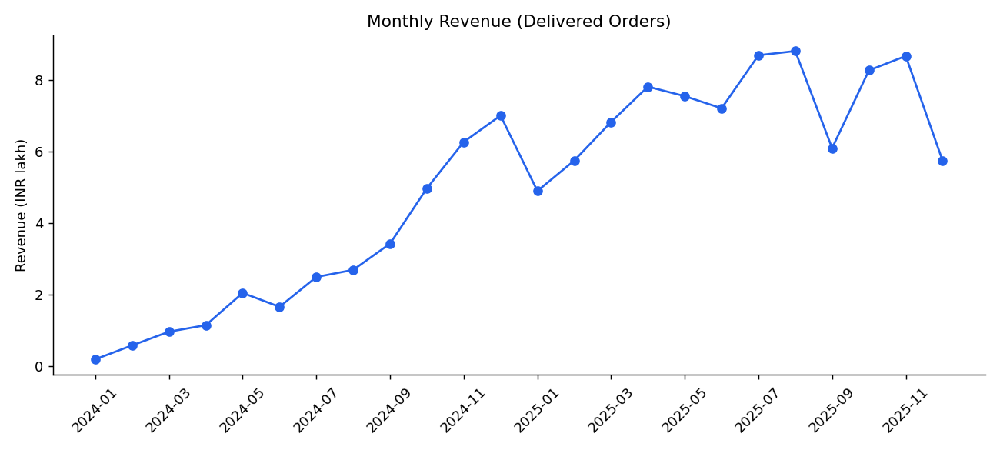
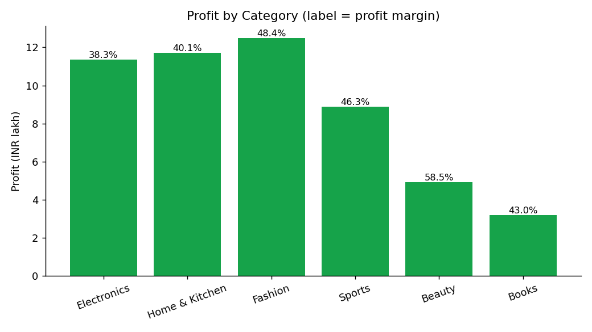
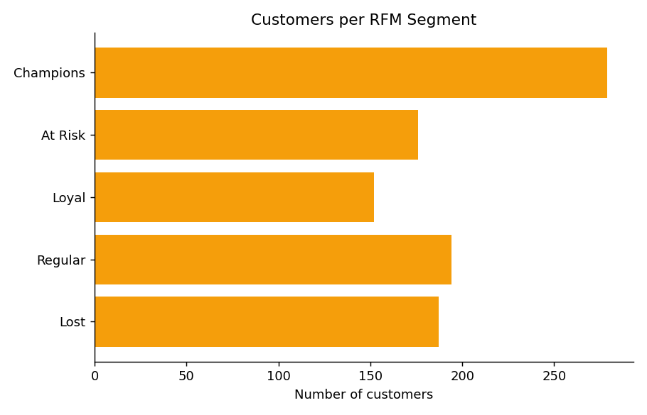

# 🛒 E-Commerce Sales Analysis using SQL

An end-to-end, beginner-friendly **SQL data analysis project**: raw messy data → cleaning → business analysis → insights.
Built with **SQL (SQLite)** + **Python (pandas, matplotlib)**.

> ℹ️ The dataset is **synthetic** (generated by `data/generate_data.py`) to mimic an Indian online store (2024–2025, amounts in ₹).
> It deliberately contains duplicates, inconsistent text and invalid values so that real data-cleaning skills can be practised.

---

## 🎯 Business Problem
The management of an online store wants to know:
1. How is the business performing overall (revenue, profit, order value)?
2. Which products, categories and cities drive growth?
3. How many orders are cancelled / returned?
4. Who are our best customers and who is about to leave?
5. Does the festive season (Oct–Nov) really boost sales?

## 🗂️ Dataset (4 tables)
| Table | Rows (raw) | Description |
|---|---|---|
| `customers` | 1,050 | customer name, email, city, signup date |
| `products` | 38 | product, category, selling price, cost |
| `orders` | 5,060 | order date, status (delivered / cancelled / returned) |
| `order_items` | 8,683 | products inside each order, quantity, discount |

```
customers 1──∞ orders 1──∞ order_items ∞──1 products
```

## 🧱 Project Structure
```
ecommerce-sql-analysis/
├── data/
│   ├── generate_data.py      # creates the synthetic dataset
│   └── raw/                  # 4 CSV files (messy raw data)
├── sql/
│   ├── 01_schema.sql         # raw tables
│   ├── 02_cleaning.sql       # cleaning -> clean tables
│   ├── 03_views.sql          # reusable views (delivered_sales, rfm_segments)
│   └── 04_analysis.sql       # 11 business queries
├── results/                  # CSV output of every query
│   └── charts/               # 3 PNG charts
├── run_project.py            # runs everything end to end
├── requirements.txt
└── README.md
```

## 🧼 Step 1 – Data Cleaning (`02_cleaning.sql`)
| Problem found | SQL technique used |
|---|---|
| 50 duplicate customers, 60 duplicate orders | `ROW_NUMBER() OVER (PARTITION BY ...)` keep first row |
| City written as `MUMBAI`, `  mumbai ` | `TRIM`, `UPPER`, `LOWER`, `SUBSTR` |
| Missing cities (NULL) | `CASE WHEN ... IS NULL` → `'Unknown'` |
| Status like `Delivered ` / `DELIVERED` | `LOWER(TRIM(status))` |
| 92 invalid quantities (0 or negative) | `WHERE quantity > 0` |

Raw tables are never modified; clean data goes into new tables.

## 🔍 Step 2 – Analysis (`04_analysis.sql`)
| # | Business question | SQL concepts |
|---|---|---|
| Q1 | Data quality check (raw vs clean rows) | `UNION ALL`, subqueries |
| Q2 | KPI summary | aggregates, `COUNT(DISTINCT)` |
| Q3 | Month-over-month growth + running total | **CTE, `LAG`, window `SUM`** |
| Q4 | Top 10 products | `GROUP BY`, `ORDER BY`, `LIMIT` |
| Q5 | Category profit margin & revenue share | `SUM() OVER ()` |
| Q6 | City performance | `JOIN`, aggregation |
| Q7 | Order status breakdown | window `%` calculation |
| Q8 | Top 3 customers per city | **`ROW_NUMBER() PARTITION BY`** |
| Q9 | Repeat vs one-time customers | CTE, `CASE WHEN` |
| Q10 | **RFM customer segmentation** | **`NTILE`, views, CTEs** |
| Q11 | Festive vs regular season | `strftime`, `CASE WHEN` |

## 📈 Key Insights
*(from the generated dataset; numbers are in ₹)*
- **Total revenue ₹1.20 crore**, profit **₹52.5 lakh (43.9% margin)** from 4,224 delivered orders. Average order value ≈ **₹2,834**.
- **Festive months (Oct–Nov) earn ~54% more per month** (₹7.04 lakh vs ₹4.58 lakh) → stock and marketing should be planned ahead of Diwali.
- **Beauty has the highest margin (58.5%)** but only 7% of revenue; **Electronics has the lowest margin (38.3%)** despite being the #1 revenue category → upsell high-margin items.
- **Air Fryer is the #1 product** (₹12.2 lakh revenue, 218 units).
- **Mumbai and Bengaluru** generate the most revenue; **Jaipur has the highest revenue per customer (₹15,955)** → small city, valuable customers.
- **~15% of orders** are cancelled (7.9%) or returned (7.1%) → worth investigating root causes.
- **RFM:** 279 "Champions" generate ~45% of customer spend, while 176 "At Risk" customers (avg. 162 days inactive, still ₹29 lakh total spend) are a good win-back campaign target.

## ✅ Recommendations
1. Run a win-back campaign (coupons/emails) for the **At Risk** segment.
2. Build festive-season inventory and ads from September.
3. Push high-margin Beauty and Fashion products with bundles.
4. Investigate cancellations and returns by category.

## ▶️ How to Run
```bash
git clone https://github.com/<your-username>/ecommerce-sql-analysis.git
cd ecommerce-sql-analysis
pip install -r requirements.txt
python data/generate_data.py     # optional: regenerates the CSVs
python run_project.py            # builds DB, runs SQL, saves results + charts
```
To explore manually, open `ecommerce.db` in **DB Browser for SQLite** (free) after running.

## 📊 Charts




## 🛠️ Tech Stack
SQL (SQLite, CTEs, window functions, views) · Python (pandas, matplotlib) · Git/GitHub

## 🚀 Future Improvements
- Move to **PostgreSQL/MySQL** and add indexes
- Build a **Power BI / Tableau** dashboard on top of the result tables
- Add a customer churn prediction model in Python (scikit-learn)

## 👤 Author
**<Your Name>** · [LinkedIn](https://linkedin.com/in/your-profile) · [GitHub](https://github.com/your-username)
